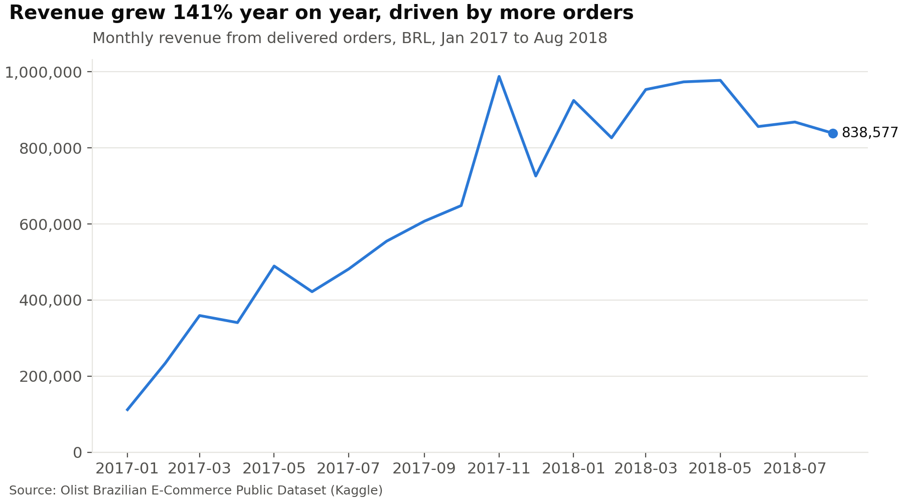
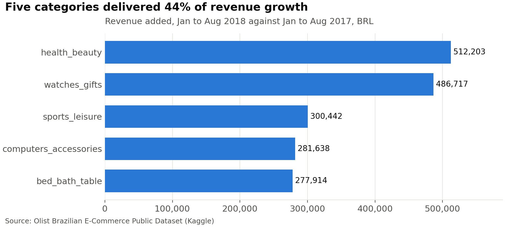
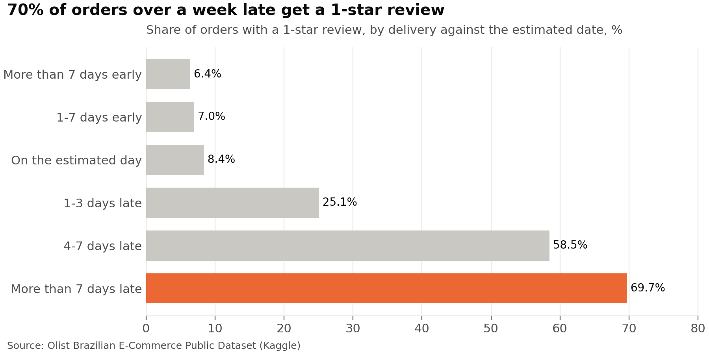
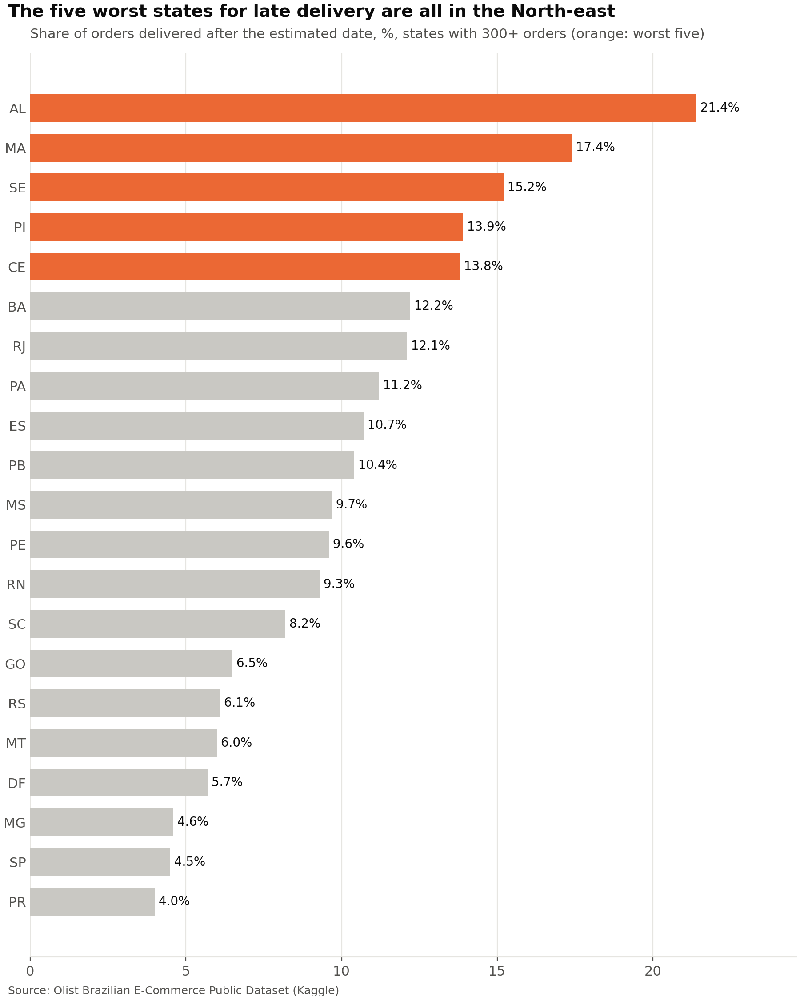

# Olist e-commerce: growth came from volume, and late deliveries drive 1-star reviews

**Orders delivered more than a week late received a 1-star review 70% of the time. Late orders were 6.7% of deliveries but produced 37% of all 1-star reviews.**

**Tools**: PostgreSQL, SQL (CTEs, window functions, conditional aggregation), Python (pandas, matplotlib)

**Data**: [Brazilian E-Commerce Public Dataset by Olist](https://www.kaggle.com/datasets/olistbr/brazilian-ecommerce), 99,441 orders across 9 linked tables, Sep 2016 to Oct 2018

---

## Business question

Olist's management wants to know what drove revenue growth between 2017 and 2018, whether customers come back, and whether delivery problems are hurting customer ratings.

## Findings

### 1. Revenue grew 141%, and the growth came from more orders, not bigger orders



Revenue from delivered orders rose from BRL 2.99M (Jan to Aug 2017) to BRL 7.22M (Jan to Aug 2018). Orders grew from 22,000 to 52,800 over the same months, while the average order value stayed flat at about BRL 136. The November 2017 spike matches Black Friday.

### 2. Five categories delivered 44% of the growth



Health & beauty added the most revenue (+BRL 512K). Watches & gifts grew fastest, more than tripling (+242%). Together the top five categories added BRL 1.86M of the BRL 4.22M increase.

### 3. Only 3% of customers ever come back

Of 94,990 customers, 2,888 (3.04%) placed a second order. The median time to the second order was 28 days. Of those repeat customers, 30% ordered again on the same day, which looks more like one shopping trip split into two orders than a return visit, so true loyalty is lower still (about 2.1%).

### 4. Late deliveries go with bad reviews



Orders that arrived more than a week early averaged 4.32 stars; orders more than a week late averaged 1.70, and 70% of them received 1 star. Only 6.7% of delivered orders were late, yet they account for 37% of all 1-star reviews.

### 5. The North-east has the worst delivery performance



The five states with the highest late-delivery rates (AL, MA, SE, PI, CE) are all in the North-east, at 14 to 21% late against 4.5% in São Paulo. Delivery to Alagoas took 24.5 days on average, almost three times São Paulo's 8.7 days, and these states also give lower review scores.

## Recommendations

- **Fix delivery to the North-east first.** Review carrier performance and delivery estimates for AL, MA, SE, PI and CE, where late rates are three to five times São Paulo's.
- **Act on orders at risk of running late.** Orders more than a week late get 1 star 70% of the time, so flag delayed orders early and set more realistic estimates on slow routes.
- **Test a second-order incentive.** With 97% of customers buying once, a follow-up offer timed around four weeks after the first purchase (the median return time) is a low-cost experiment.
- **Back the growth categories.** Health & beauty and watches & gifts drove a quarter of all growth; seller recruitment and promotion there has the clearest payoff.

## Data and method

- **Source:** nine linked tables loaded into PostgreSQL (`sql/00_create_schema.sql`, `sql/01_load_data.sql`).
- **Data quality checks:** `sql/02_data_checks.sql`, with findings and decisions in [notes/data_quality.md](notes/data_quality.md).
- **Key decisions:**
  - Revenue counts delivered orders only (97% of orders) and uses item price, excluding freight.
  - Year-on-year comparisons use Jan to Aug of each year, because 2016 and Sep to Oct 2018 are incomplete.
  - Review scores are averaged per order first, so the 547 orders with several reviews are not counted twice.
  - Repeat customers are counted with `customer_unique_id`, since Olist creates a new `customer_id` for every order.
  - State results include only states with at least 300 delivered orders (21 of 27).
- **Queries:** one file per question in `sql/` (`10_q1` to `13_q4`); results in `results/`; charts made with `charts/make_charts.py`.

## Limitations

- The data covers one Brazilian marketplace from 2016 to 2018, so patterns may differ elsewhere or today.
- Delivery delays and low scores are associated, which does not prove that lateness causes them; product quality and seller behaviour could also play a part.
- Revenue excludes freight and instalment charges, so it measures product sales rather than cash collected.

## How to run it

See [SETUP.md](SETUP.md). In short: install PostgreSQL, download the data from Kaggle into `data/raw/`, then run the SQL files in number order.

## Project structure

```
olist-sales-analysis/
├── README.md              this page
├── SETUP.md               step-by-step setup
├── sql/
│   ├── 00_create_schema.sql
│   ├── 01_load_data.sql
│   ├── 02_data_checks.sql
│   └── 10_q1 ... 13_q4    one file per business question
├── results/               query outputs as CSV
├── charts/                chart script and PNG charts
├── notes/                 data quality notes
└── data/raw/              Kaggle CSVs (not committed)
```

---

Olorunmaiye Peter Ayanfe | https://ayanfedara.github.io/
